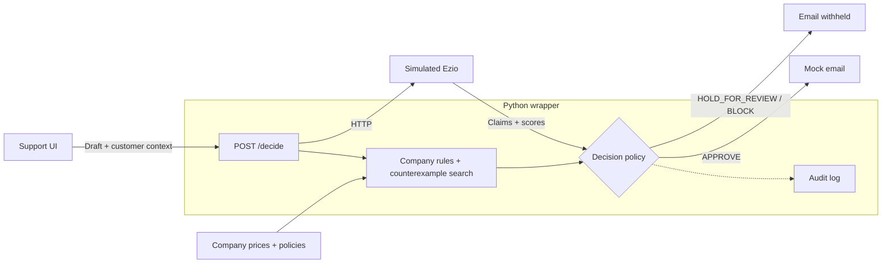

# False Promises — Find the Exception

**Before AI sends a promise, we look for a customer who makes it false.**

A customer-support approval gate for fictional Lumen Cloud. We combine simulated Ezio signals with company prices and policies to **APPROVE**, **HOLD_FOR_REVIEW**, or **BLOCK** a draft before its mock email can run.

Our distinguishing check finds a concrete customer who disproves a discount promise, with the failed condition and policy source. A GREEN aggregate score never overrides that evidence.

| Submission detail | Value |
|---|---|
| Team / track | False Promises / Approval Gate |
| Persona / gated action | Customer support lead / `send_email` |
| Language | Python 3.9+, standard library; HTML/CSS/JavaScript UI |
| Exact wrapper start command | `python3 wrapper/serve.py` |
| Persona UI | Yes — draft composer, decision evidence, customer comparison, review and audit trail |
| Recorded measured score | **50.0 / 50** — final run completed October 10, 2026, 2:51 PM Pacific |

## Run the demo

Requires Python 3.9+ and Git. No package installation, live API keys, or external services are needed at runtime.

```bash
git clone https://github.com/prathamsnehi/false-promises-hack-26.git
cd false-promises-hack-26
python3 gate.py serve --persona customer_support
```

Open the printed local URL. This starts the UI, wrapper, and simulated Ezio together; Ctrl-C stops them. The harness configures the wrapper automatically; no `GATE_WRAPPER_CMD` override is needed.

## Architecture



## Two-minute walkthrough

Use the UI examples or the **11 vs. 12 month test** with this draft:

> You qualify for our 15% loyalty discount on the Pro plan.

| Customer / draft | Expected decision | Mock email |
|---|---|---|
| Pro customer, 12 months | APPROVE — loyalty eligibility satisfied | Executes |
| Pro customer, 11 months | BLOCK — policy requires at least 12 months | Withheld |
| Product delivery promise (review example) | HOLD_FOR_REVIEW — manager review required | Withheld |

Inspect the blocked customer's evidence, then log a revision request on the held draft and open the audit trail. Reviews send nothing; revised drafts need a fresh decision. Judges can also enter their own drafts.

## Decision policy

Company-policy or Ezio claim contradictions **block**. Tone, bias, or agreement below 80 **holds for review**. Missing upstream evidence holds after bounded retries, preserving known local blocks. Only **APPROVE** runs the mock email. Every decision is audited. The one-page policy below explains all signals, thresholds, justifications, and failure behavior.

## Submission evidence

| Item | Location |
|---|---|
| Repository | [false-promises-hack-26](https://github.com/prathamsnehi/false-promises-hack-26) |
| One-page decision policy | [Signals, thresholds, justifications, and failures](docs/decision-policy.md) |
| Audit-log sample | [Practice-only `gate.py try` excerpts](docs/audit-sample.md) |
| Persona UI screenshots | [Boundary comparison](docs/ui-boundary.png) · [Evidence](docs/ui-evidence.png) · [Review](docs/ui-review.png) |
| Final results screenshot | [Team, run time, and measured score](docs/final-results.png) |
| Official result files | `results/False Promises.json` and `results/False Promises.report.md` — submit unchanged as separate attachments |
| Devpost project | Link still to be added by the team |

Recorded result: **35/35 held-out + 15/15 failure handling**, no harness flags; the wrapper fingerprint matches the current source. The remaining 50 points are judge-scored. Official result files are excluded from Git because they contain held-out inputs.

## Verify or reproduce

```bash
# Local regression checks
python3 -m unittest test_contract test_harness test_source_checks test_decisions test_reviews

# Practice decisions and all six failure drills
python3 gate.py practice --persona customer_support --team "False Promises" --no-show

# Official run; enter the organizer-provided passphrase when prompted
python3 gate.py judge --persona customer_support --team "False Promises"
python3 gate.py results
```

The results viewer opens the newest run; select the final run when capturing the submission screenshot. Complete the personal confirmations in the [submission requirements](docs/project-submission-requirements.md).

We built the policy checks, counterexample search, decision logic, review records, and UI on the supplied mock and harness, with Codex assistance. This prototype uses fictional data, bounded language rules, and simulated email; approval does not verify every sentence. See the [implementation walkthrough](docs/implementation-walkthrough.md) and [original challenge guide](docs/challenge-guide.md).
