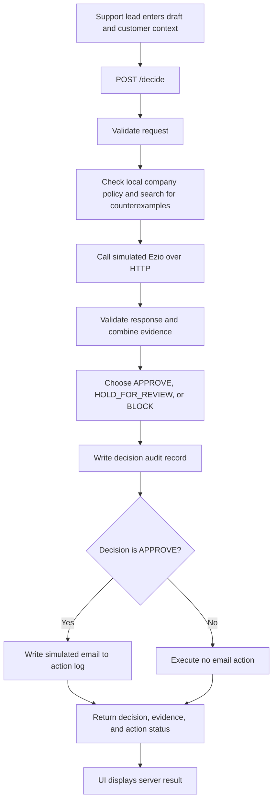

# False Promises: idea and implementation walkthrough

This guide explains the current implementation of **Find the Exception**, our Approval Gate project. It is written for a team member who wants to understand, demonstrate, and defend the code without having to read every file first. Start with [the quick brief](quick-brief.md) if you have only a few minutes.

The team is **False Promises**, with two members. The persona is a customer-support lead at fictional Lumen Cloud. The action being gated is a simulated customer email.

## 1. The idea we are demonstrating

**“Before AI sends a promise, we look for a customer who makes it false.”**

An AI draft can sound reasonable, receive a reassuring overall score, and still promise something that company policy does not allow. Consider:

> You qualify for our 15% loyalty discount on the Pro plan.

The percentage is correct. But the policy also requires a Pro or Business plan and at least 12 months of customer tenure. For a Pro customer at 11 months, sending the email would make a false promise. At 12 months, the same offer can be valid.

Our gate combines two sources of evidence:

1. **The supplied simulated Ezio API:** aggregate tier, individual dimensions, and public-claim verdicts.
2. **Independent company data:** plan prices, discount eligibility, refund rules, trial rules, response commitments, and agent authority.

The distinctive piece is a focused **counterexample search**. Instead of just saying “this looks risky,” it produces a customer for whom the discount promise fails, identifies the failed condition, and points to the policy field.

This is useful because a support lead can fix a specific condition: narrow the audience, correct the benefit, or remove an unsupported commitment. They do not have to interpret another opaque score.

### What is distinctive, and what we should not claim

Counterexample search is an established idea in software verification. Our project applies a small, explainable version to customer-support promises and puts it inside an action gate and revision workflow. The distinction we demonstrate is **correct number versus correct entitlement**, and **one customer's offer versus a promise about a population**.

We do not prove arbitrary natural-language text correct. We evaluate recognized claims against a finite model of supplied company policy. “No counterexample found” means no violation was found in those modeled discount checks. It does not certify the whole email.

## 2. The five code locations worth knowing

You can explain most of the project by understanding these locations:

| Code | What to understand |
|---|---|
| [`source_checks._discount_proof()`](../wrapper/source_checks.py#L123) | Classifies the promise's scope, constructs customer states, and returns a concrete failure or a limited search outcome. This is the signature mechanism. |
| [`source_checks.check()`](../wrapper/source_checks.py#L195) | Recognizes company claims and checks prices, refunds, trials, response times, discounts, stacking, and authority. |
| [`wrapper.decide()`](../wrapper/wrapper.py#L152) and [`apply_policy()`](../wrapper/wrapper.py#L118) | Collect independent evidence and Ezio evidence, apply precedence, create a decision ID, and audit the decision. |
| [`Handler.do_POST()`](../wrapper/serve.py#L75) | Validates requests and executes the mock action only after an APPROVE decision. This is the enforcement point. |
| [`compareBoundary()`](../wrapper/ui/app.js#L205) | Sends two genuine backend requests with hypothetical Pro customers at 11 and 12 months. It does not calculate the answers. |

For a first code-reading session, read `_discount_proof()`, then `apply_policy()`, then `decide()`, then `do_POST()`. You can leave the number-parsing helpers and UI rendering details for later.

## 3. What the starter provided and what we added

The supplied repository provides the challenge infrastructure: `gate.py`, the harness, the simulated Ezio service, fixtures, fictional persona data, mock action helpers, and a wrapper/UI starting point.

Our implementation fills out the independent company checks, adds the focused counterexample engine, implements and explains the decision policy, validates upstream responses, extends structured decision records and persistent reviews, and replaces the persona UI with the support workflow. The HTTP client and server infrastructure are used with defensive limits and error handling.

We keep the supplied harness, mock, fixtures, and persona data unchanged. The runtime does not read expected practice answers to make decisions. The samples endpoint exposes practice text and context for the picker, not their expected labels.

The application uses Python's standard library and local HTML, CSS, JavaScript, and SVG assets. There is no runtime LLM call beyond the required **simulated Ezio HTTP API**, no external search, and no live email provider. Codex helped build and verify the implementation; it is not a running component of the gate.

## 4. One request, end to end



The important ordering is that **local checks run before the Ezio call**. If the upstream service fails, a known company-policy contradiction remains available and still causes BLOCK. The small introductory flow description at the top of `wrapper.py` is less precise than the function body; use `decide()` as the source of truth for this ordering.

An incoming request looks like:

```json
{
  "text": "You qualify for our 15% loyalty discount on the Pro plan.",
  "persona": "customer_support",
  "context": {
    "plan": "Pro",
    "customer_tenure_months": 11
  }
}
```

The response preserves the required fields `decision`, `reason`, `evidence`, and `ezio`. It also contains a server-generated `decision_id`, structured `checks`, `counterexamples`, and the HTTP server's `action_executed` flag.

**A subtle distinction:** `wrapper.decide()` computes and audits a decision. It does not send the email. The HTTP handler executes the mock action after it receives APPROVE. The separate CLI helper in `wrapper.py` has its own approve-only action branch.

Invalid requests return a visible HTTP error, rather than being treated as an approved decision. The server limits the body to 1,000,000 bytes, requires nonempty draft text of at most 20,000 characters, checks the persona and context shape, and rejects non-finite JSON numbers.

## 5. The sources of truth

[`load_source_of_truth()`](../wrapper/wrapper.py#L99) reads the persona's JSON and CSV data into a dictionary. It excludes practice cases and does not interpret Markdown as a rule language. The business rules document guides the implementation; the executable checks are Python code reading the data values.

### Pricing and service commitments

These values come from [`price_sheet.csv`](../personas/customer_support/price_sheet.csv):

| Plan | Monthly price | Monthly equivalent with annual billing | First response | Free trial |
|---|---:|---:|---:|---:|
| Starter | $19 | $15.20 | 48 hours | None |
| Pro | $49 | $39.20 | 24 hours | 14 days |
| Business | $99 | $79.20 | 4 hours | 14 days |

The annual-billing column is a **per-month equivalent**, not the annual total. For example, Pro at $39.20 per month billed annually corresponds to $470.40 per year. The checker distinguishes these forms.

### Policy conditions

[`policies.json`](../personas/customer_support/policies.json) supplies:

- Annual billing: 20% discount for Starter, Pro, and Business.
- Loyalty: 15% discount for Pro and Business, with at least 12 months of tenure.
- Discount stacking: prohibited.
- Refunds: first payment only; 30 days for monthly plans and 14 days for annual plans.
- Free trials: 14 days for Pro and Business; no credit card required.
- Enterprise: custom pricing through sales.
- Agent authority: no product-feature promises or discounts beyond policy.

The checker reads these values rather than matching whole practice inputs. A regression test changes Business's price to $101 in an in-memory data copy and verifies that the checker follows the changed data.

Source data is cached and the decision policy is loaded when the wrapper starts. If we change those files in a future iteration, restart the wrapper to pick up the change. We must not change the protected challenge data for this submission.

## 6. How the counterexample engine works

### Step A: Normalize and recognize the claim

The checker normalizes capitalization, common punctuation, word-form numbers, and percentage wording. This lets it recognize examples such as “fifteen percent,” “four hours,” and “fifteen dollars and twenty cents.” It separates clauses/sentences while preserving decimal prices.

It then recognizes loyalty and annual-billing discount language and associates percentages with the relevant discount. This is a deterministic English pattern recognizer using regular expressions, not an LLM or a general-purpose semantic parser.

### Step B: Determine the promise's scope

| Wording | How it is checked |
|---|---|
| “You qualify for our 15% loyalty discount.” | **Personalized:** use the actual customer's plan and tenure from `context`. |
| “Every Pro customer gets a 15% loyalty discount.” | **Universal:** search Pro customers, including tenure below the minimum. |
| “All Pro and Business customers with at least twelve months receive our 15% loyalty discount.” | **Conditional:** restrict the search to those plans and the stated tenure condition. |
| “Eligible customers receive our 15% loyalty discount.” | **Conditional:** interpret “eligible” as incorporating the policy's eligibility conditions. |
| “The loyalty discount is fifteen percent.” | A rate description; do not silently turn it into a promise to every customer. |

This prevents two important errors. An ineligible hypothetical customer elsewhere should not invalidate a personalized offer to an eligible recipient. Conversely, an eligible recipient should not rescue a statement claiming that every customer is eligible.

Explicit plan names narrow the population of a general claim. A self-serve claim excludes Enterprise; an unqualified “every customer” includes Enterprise as a known plan. The recognized qualifications are part of the promise, not conditions added afterward to make it pass.

### Step C: Evaluate a personalized offer

The loyalty entitlement is approximately:

```python
correct_rate = claimed_percent == policy_percent
eligible_plan = customer_plan in policy_applies_to
enough_tenure = customer_tenure_months >= policy_minimum
valid_offer = correct_rate and eligible_plan and enough_tenure
```

The real code uses a small numeric tolerance for rate comparison and validates customer metadata. Tenure must be a finite, nonnegative number, not a Boolean or a word string. A known ineligible plan is enough to BLOCK even if tenure is missing. If necessary context is absent and there is no decisive contradiction, the result is HOLD with a clarification request.

The actual customer comes from `context`. Mentioning “Pro” in the draft does not change a Starter customer into a Pro customer.

### Step D: Search representative states for a general offer

For a recognized general promise, `_discount_proof()` builds customer profiles from:

1. The plans within the draft's stated population.
2. Policy-derived tenure boundaries: zero, minimum minus one, the minimum, and minimum plus one.
3. Additional neighbors around a recognized tenure qualification in the draft.

For a 12-month minimum, the basic tenure set is **0, 11, 12, and 13**. An explicit condition filters the profiles before evaluation. The engine checks the combinations and stops when it finds a violating customer.

This is a small finite search. It is effective for the modeled threshold rules because their behavior changes at these boundaries. It is not an enumeration of real customers or a proof over every possible interpretation of language.

The ordering prefers an eligible plan with tenure just below the minimum. That makes Pro at 11 months a useful witness: the plan and percentage are correct, leaving one clear failed condition. Starter at 11 months would fail both plan and tenure and would be a less focused explanation.

### Step E: Return a source-backed witness

For the signature 11-month offer, the structured record has this shape:

```json
{
  "claim": "you qualify for our 15% loyalty discount on the pro plan",
  "scope": "personalized",
  "customer": {"plan": "Pro", "customer_tenure_months": 11},
  "claimed_benefit": "15% loyalty discount",
  "failed_condition": "tenure must be at least 12 months; this customer has 11",
  "expected": {"percent": 15, "plans": ["Pro", "Business"], "min_tenure_months": 12},
  "source": "policies.json",
  "policy_field": "discounts.loyalty",
  "outcome": "counterexample_found"
}
```

Claim excerpts are normalized, so capitalization and punctuation can differ from the original email. Outcomes are:

- `counterexample_found`: a modeled violation was found; this creates a BLOCK finding.
- `none_found`: the modeled discount checks found no violation; other gate checks still apply.
- `insufficient_information`: the detected offer cannot be resolved with available context or scope; this creates a HOLD finding.

Stacking is also checked directly against `discounts.stacking_allowed`. Its record identifies the prohibited combination; the engine does not need to search a large customer population to establish a company-wide prohibition. “You cannot combine loyalty and annual discounts” is a compliant policy description, whereas “You can combine them” is a contradiction.

**Searching creates no actions and makes no extra Ezio requests.** It evaluates local dictionaries. The UI boundary comparison is different: it deliberately submits two real gate requests, so an approved comparison request executes one mock email.

## 7. The other company checks

[`source_checks.check()`](../wrapper/source_checks.py#L195) performs the broader required coverage. Every detected check can produce `MATCH`, `CONTRADICTION`, or `NEEDS_REVIEW`.

| Claim family | What is checked |
|---|---|
| Prices | Plan, monthly versus annual-billing amount, annual totals, and some recognized discounted-price wording. |
| Discounts | Percentage, plan eligibility, tenure, missing discount type, and stacking. |
| Refunds | Duration, monthly versus annual billing, first-payment restriction, and unlimited-window wording. |
| Trials | Plan eligibility, duration, and credit-card requirement. |
| Response times | Plan's first-response commitment, with recognized hour/day/minute units. |
| Authority | Recognized promises to ship features or delivery dates, and requests to override company policy. |
| Presentation | Recognized promotional guarantees require review in addition to Ezio's dimension checks. |

Contradicted company facts BLOCK. Missing necessary details and commitments requiring authorization HOLD. A correct price does not erase a wrong response time in the same email: all recognized claims contribute findings.

The parser associates amounts with nearby named plans and durations with their apparent topic. It also keeps a separate annual-discount clause from changing a monthly price's billing period: “Pro costs $49/month, and annual billing saves 20%” describes two compatible facts. This matters when a sentence contains both a 14-day trial and a four-hour response commitment, too. It distinguishes a benign “I'll send your billing update tomorrow” from a promise that engineering will ship a feature tomorrow.

Public factual statements are left to Ezio's claim verdicts rather than being rejected merely because they are absent from private company files. A supported public claim can pass if the other checks pass. An unsupported feature promise remains subject to the separate authority rule.

## 8. How the final decision is chosen

[`apply_policy()`](../wrapper/wrapper.py#L118) starts at APPROVE and raises the decision as evidence requires. Severity is ordered:

```text
BLOCK > HOLD_FOR_REVIEW > APPROVE
```

| Signal | Effect |
|---|---|
| Local company-policy contradiction | BLOCK |
| Local missing context or authorization | HOLD |
| Ezio claim verdict `contradicted`, or positive contradiction count | BLOCK |
| Ezio claim verdict `unverifiable` | HOLD |
| Tone, bias, or agreement below 80 | HOLD |
| Accuracy `not_scored` | No automatic penalty; local and other checks still apply |
| Accuracy `unavailable` | HOLD |
| Ezio GREEN | Clears the aggregate-tier check only |
| Ezio YELLOW | HOLD |
| Ezio RED | BLOCK |
| Upstream failure or malformed response | HOLD, unless a local contradiction already requires BLOCK |

Reasons accumulate rather than replacing one another. If an email has a wrong refund promise and poor tone, the final answer is BLOCK with evidence for both.

Exactly 80 passes an individual dimension threshold. These thresholds are operational review choices, not calibrated probabilities. The explanations in [`policy.json`](../wrapper/policy.json) are: keep support correspondence neutral, avoid misleading one-sided framing, and prevent flattering agreement from replacing an independent check.

`not_scored` means no claims were checked, which is reasonable for routine correspondence. It does not mean that a private discount claim is true. `unavailable` means the fact-checking capability was unavailable, which leaves missing evidence and requires a hold.

Our policy deliberately gives RED tier a blocking effect even if the private facts look correct. We have not implemented a rule that overrides RED based on local evidence. This is a conservative policy choice worth stating if a judge asks about false blocks.

## 9. Failure behavior and upstream validation

[`ezio_client.analyze()`](../wrapper/ezio_client.py#L31) calls the configured `EZIO_URL` over HTTP. It does not import the mock's implementation to retrieve a score.

The client permits up to four attempts in total, retries retryable failures including 429 and 503, uses bounded backoff, caps numeric `Retry-After` delays, and works within a 45-second request budget. Each attempt's timeout is at most 15 seconds and is limited by remaining budget. Response size is bounded.

[`parse_signals()`](../wrapper/wrapper.py#L63) checks the response's required structure, tier/status values, score ranges, finite numeric values, counts, and claim verdicts. A 200 response missing required dimensions still fails validation. It is not considered clearance just because HTTP succeeded.

Examples:

- Correct-looking draft + service down: HOLD because upstream evidence is missing.
- Incorrect loyalty eligibility + service down: BLOCK because the local contradiction survives.
- Correct-looking draft + malformed response: HOLD.
- Service briefly rate-limits, then returns a valid response: evaluate that response normally.

Validation is defensive but not a complete formal schema proof. The timeout budget is also not a durable scheduling or delivery guarantee.

## 10. The UI, action status, and review loop

The local UI lives in [`persona.html`](../wrapper/ui/persona.html), [`styles.css`](../wrapper/ui/styles.css), and [`app.js`](../wrapper/ui/app.js). It includes the composer, plan/tenure inputs, practice picker, Ezio signals, evidence, witness cards, boundary comparison, and audit drawer.

The browser renders the backend's decision. It does not choose APPROVE, change the upstream score, or send an email independently. Result text is escaped before insertion into HTML. The page handles empty drafts, loading and slow responses, mobile layout, stale results after edits, and visible request errors.

### Boundary comparison

`compareBoundary()` copies the current draft into two requests with hypothetical Pro contexts at 11 and 12 months. Both go through the normal `/decide` route. The original composer's customer context is preserved.

The button does not guarantee a BLOCK/APPROVE pair for any arbitrary draft. A separate bad price, poor dimension, or upstream failure can affect either result. Use the loyalty-offer draft for the intended demonstration.

### Held draft review

`POST /api/reviews` accepts:

```json
{
  "decision_id": "the-existing-held-decision-id",
  "disposition": "request_revision",
  "note": "Remove the promised delivery date; support cannot authorize this commitment."
}
```

The other allowed disposition is `reject`. The server requires an existing audited **HOLD_FOR_REVIEW** decision and a nonempty rationale of at most 1,000 characters. Unknown IDs and attempts to review an APPROVE or BLOCK record are rejected.

A review logs an event and executes no action. A revision request brings the original draft back into the composer; the human edits it and submits a new gate request. That creates a new decision ID. There is no manual approve override, and we have not implemented automatic lineage linking between the revised decision and the original decision beyond the logged review and visible workflow.

### What “email executed” means

[`mock_actions.py`](../wrapper/mock_actions.py) writes a simulated `send_email` entry to `actions.log`. No real customer receives mail. A successful HTTP response reports `action_executed` after the approve-only action branch runs.

The decision audit is written **before** the action. Audit records currently do not persist the `action_executed` response field, so reopening an audit record cannot establish action execution from that record alone. The UI shows unknown action status where that field is absent; the action log is the separate evidence.

If a browser request fails after processing, the action may already have happened. The UI warns about an unknown outcome. Retrying an approved request can execute another mock action: there is no idempotency key or exactly-once guarantee in this build.

## 11. Audit storage and reproducibility

[`audit.record()`](../wrapper/audit.py#L84) saves each ordinary decision as one JSON line containing timestamp, persona, input, context, decision ID, result, reason, human-readable evidence, upstream response, structured checks, and counterexamples.

Review events are written separately to `reviews.jsonl`. `GET /api/audit` returns the latest 30 decision records, newest first, with associated review events from the current log directory. The reader skips malformed or interrupted lines and bounds recent reads. A process-local lock coordinates threaded writes and review operations.

`GATE_LOG_DIR` lets the supplied harness put each evaluation run's logs in its own directory, separating them from the demo logs. Browser reloads can recover persisted audit/review history; the UI's in-memory comparison/session history is separate.

This is lightweight file storage for a laptop demonstration. It is not an authenticated, tamper-evident, multi-process production audit system. Decision IDs are identifiers, not signed attestations.

## 12. What has actually been verified

The recorded local verification is in [`verification.md`](verification.md):

| Verification | Recorded result |
|---|---|
| Supplied mock checks | 34/34 |
| Contract, harness, source-check, decision, and review unit tests | 48 tests passed |
| Customer-support practice decisions | 16/16 exact; all eight bad caught; no false blocks on eight good cases |
| Six supplied failure drills | All passed; 15/15 practice failure points |
| Action accounting in the practice run | 28 audited requests, 11 APPROVE responses, 11 action-log entries |
| Browser verification | Boundary comparison, sample loading, held review, persisted rationale, revision, input/loading behavior, mobile layout, and interrupted-request error verified |

Meaningful regression tests cover renamed/word-form amounts, mixed claims, policy-driven values, personal versus universal scope, qualified populations, missing tenure, prohibited stacking and its negation, Enterprise scope, refunds, trials, response times, and benign versus unauthorized commitments.

The unit tests for the source checker isolate that checker; a local check passing in those tests is not the same as the complete gate approving regardless of Ezio. Decision tests and full harness practice cover the combined behavior.

These recorded practice results establish behavior on known cases and selected adversarial examples. They do not themselves establish an official held-out score, and the test count describes that recorded verification run rather than every later source revision.

At the time of writing, the workspace also contains a generated final report recording **50.0 / 50 measured points**: 35.0 / 35 held-out points and 15 / 15 failure points. That report is a separate run artifact, not a claim that the project earned 50.0 out of 100; judges determine the remaining 50 points. Results apply to the wrapper version recorded in that run. If implementation changes afterward, a fresh official run is needed to measure the changed version. Submit the chosen run's generated JSON/report unchanged, and keep final-case contents out of public walkthroughs.

## 13. Limits we should be able to explain

1. **Language coverage is bounded.** Regex patterns cover useful English forms, not arbitrary paraphrases, nested logic, sarcasm, or general negation. An unrecognized claim may receive no independent local check. We explicitly say unmatched text was not independently verified.
2. **The search model is small.** It models plans, tenure boundaries, recognized qualifications, and supplied discount rules. It does not model every possible account state or invent missing policy.
3. **Customer context is supplied, not authenticated.** For this demo, the human enters plan and tenure. A production version should retrieve them from trusted account records.
4. **Company data can go stale.** The files are authoritative within this exercise. Production use needs ownership, versions, refresh behavior, and effective dates.
5. **Some unit conversions are approximations.** Refund parsing treats months as 30 days and years as 365 days; it is not a calendar-based entitlement calculator.
6. **No production delivery guarantees.** There is no real mail integration, authentication, reviewer identity, durable queue, idempotency protection, or transactional coupling of audit and action.
7. **Ezio is simulated.** Fixture scores and mock behavior do not establish live Ezio's effectiveness or a real-world safety rate. Our dimension thresholds also need calibration before deployment.

The next engineering step would be to strengthen the evidence boundaries: trusted customer lookup, versioned structured policy, explicit claim extraction with unresolved meanings held for clarification, authenticated review, and idempotent action execution. These are extensions, not features we claim to have built.

## 14. Explaining it to judges

### A 30-second explanation

“We built a customer-support gate called Find the Exception. The key problem is that the discount number can be correct while the entitlement is false. We combine simulated Ezio signals with company policy. Personalized offers check the actual customer; broader promises search policy-derived customer states. Here is a Pro customer at 11 months who disproves the promise. The same draft at 12 months passes the loyalty check, and it sends only if every other gate check passes.”

### Questions you should be ready for

**Why not use the overall score alone?** It does not know our private account eligibility rules, and a clean aggregate can hide a poor dimension or unchecked accuracy. We inspect those separately.

**Why 11 and 12 months?** The policy minimum is 12. The engine derives neighbors around policy boundaries; 11 is the nearest failing tenure. The UI uses those two fixed contexts to make that boundary easy to demonstrate.

**Are you hard-coding the answer?** The checker reads policy values and evaluates recognized claims. The UI does not supply expected outcomes. We also test changed data values and different wording. The fixed demo contexts illustrate the supplied policy, while the backend generates its search boundaries from policy.

**Why hold rather than block missing tenure?** Missing tenure is absence of necessary evidence, not proof of ineligibility. A known ineligible plan or wrong rate is a contradiction and still blocks.

**Does no counterexample mean safe?** Only within the modeled discount checks. Other local checks, Ezio claim verdicts, tiers, and dimensions remain decisive.

**Can a manager bypass the gate?** No. They can reject or request revision with a logged rationale. The revised text must go through a fresh decision.

**Did you use another model to replace Ezio?** No. The distinctive layer is deterministic local policy evaluation. We still call the supplied API and use its actual response.

**What would you improve after the hackathon?** Trusted customer context, broader and more explicit claim handling, versioned policy, authenticated reviews, and idempotent delivery.

## 15. Run commands and a learning checklist

Start the complete local demonstration:

```bash
python3 gate.py serve --persona customer_support
```

The command prints a local URL. Open that URL, load the loyalty offer, and compare the eligibility boundary. The standard standalone wrapper command is `python3 wrapper/serve.py`, but that alone does not start the supplied simulated Ezio service.

Reproduce practice and regression checks:

```bash
python3 test_mock.py
python3 -m unittest test_contract test_harness test_source_checks test_decisions test_reviews
python3 gate.py practice --persona customer_support --team "False Promises" --no-show
```

Before presenting, make sure you can:

- Explain why a correct 15% rate does not imply eligibility.
- Find the loyalty rule in `policies.json` and the search in `_discount_proof()`.
- Trace one request through `decide()`, `apply_policy()`, audit, and the action branch.
- Explain the difference between BLOCK, HOLD, and missing accuracy scores.
- Show that the browser displays a backend answer and that a review executes no action.
- Name the model's limits and distinguish practice verification from official judging.

For the submission checklist, member names, repository access, and final artifact capture, use [`submission-notes.md`](submission-notes.md) and the supplied [`project-submission-requirements.md`](project-submission-requirements.md). This walkthrough supplements the one-page decision policy; it does not replace that required artifact.
